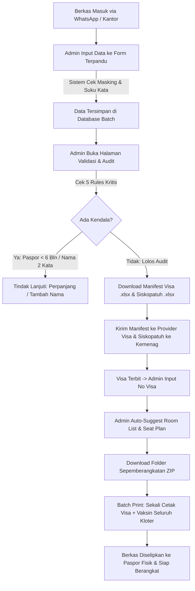

# PRODUCT REQUIREMENTS DOCUMENT (PRD)
## Sistem Operasional Terpadu Haji & Umrah
**Entitas:** AWI Tour Haji & Umrah (Yogyakarta)  
**Status Dokumen:** Disetujui (Approved)  
**Target Pengguna Utama:** Admin Operasional & Pimpinan Travel  

---

### 1. Latar Belakang & Analisis Masalah

AWI Tour Haji & Umrah merupakan perusahaan penyelenggara perjalanan ibadah umrah dan haji khusus yang berkedudukan di D.I. Yogyakarta. Dalam operasional hariannya, bagian administrasi menghadapi beban kerja yang tinggi (*bottleneck*) terkait pengelolaan dokumen fisik dan data jamaah yang masih dilakukan secara manual:
1. **Pengumpulan Berkas Parsial via WhatsApp:** Berkas pendaftaran (KTP, KK, Akta Lahir/Nikah/Ijazah, Scan Paspor Asli, dan Sertifikat Vaksin) dikirimkan jamaah melalui pesan chat WhatsApp, lalu diunduh dan diarsipkan manual ke folder lokal komputer per tanggal keberangkatan.
2. **Tingginya Risiko Human Error (Kesalahan Input):** Kesalahan penulisan satu huruf pada nama, satu angka pada nomor paspor, atau tanggal lahir berakibat fatal: visa ditolak oleh Otoritas Imigrasi Arab Saudi dan jamaah berisiko gagal berangkat.
3. **Kebutuhan Format Ekspor Ganda yang Berbeda:**
   - **Manifest Visa:** Format spesifik yang diminta oleh pihak provider visa dan *muassasah* di Arab Saudi untuk penerbitan visa umrah/haji.
   - **Siskopatuh Kemenag:** Format resmi dari Kementerian Agama RI untuk registrasi porsi dan pencetakan ID Card jamaah.
4. **Kesulitan dalam Plotting Kamar Hotel & Kursi Pesawat:** Admin kesulitan membagi kamar hotel (*Room List*) dan denah pesawat (*Seat Plan*) karena harus mengecek acuan Nomor Kartu Keluarga (KK) satu per satu untuk memastikan anggota keluarga tetap bersama, pemisahan gender non-mahram, dan prioritas lansia.
5. **Ketiadaan Pemantauan Kuota & Keuangan Real-Time:** Sulit melihat sisa kursi pesawat yang masih kosong pada tanggal tertentu serta melacak status pembayaran DP/Lunas dan distribusi perlengkapan.

---

### 2. Tujuan & Sasaran Produk

1. **Meminimalisir Kesalahan Input Hingga 0%:** Memandu admin menginput data esensial dengan validasi otomatis (panjang digit NIK, format baku nomor paspor, deteksi jumlah suku kata nama, dan masa berlaku paspor minimal 6 bulan).
2. **Efisiensi Waktu Operasional:** Mengubah proses penyusunan Manifest, Siskopatuh, Room List, dan Seat Plan dari yang sebelumnya memakan waktu berhari-hari menjadi sekali klik (hitungan detik).
3. **Pusat Audit Kelayakan Dokumen:** Menyediakan halaman kendali (*Validation Page*) dengan indikator status otomatis untuk memeriksa kesiapan berkas sebelum diajukan ke pihak luar.
4. **Pengarsipan & Cetak Otomatis:** Menghasilkan file ZIP "Folder Sepemberangkatan" yang otomatis mengelompokkan scan berkas per folder kategori dokumen, serta menyediakan fitur *Batch Print* sekali cetak untuk seluruh e-Visa dan Sertifikat Vaksin satu kloter.

---

### 3. Profil Pengguna (User Personas)

| Peran Pengguna | Tanggung Jawab Utama | Kebutuhan Fitur di Sistem |
| :--- | :--- | :--- |
| **Admin Operasional** *(Primary User)* | Menginput data jamaah dari WhatsApp, memvalidasi dokumen, menyusun kamar & kursi, mencatat pembayaran, membagikan perlengkapan, dan mencetak berkas. | • Form input terpandu (*strict masking*)<br>• Matriks audit 5 aturan validasi<br>• Tombol ekspor Manifest & Siskopatuh (.xlsx)<br>• Auto-suggest Room List & Seat Plan<br>• Fitur Cetak Massal (Batch Print PDF)<br>• Download arsip ZIP per kategori |
| **Pimpinan / Owner** *(Executive User)* | Memantau keterisian kuota kursi per keberangkatan, memonitor arus kas pembayaran (DP/Lunas), dan mengecek kesiapan kloter. | • Dashboard eksekutif *real-time*<br>• Grafik sisa kuota kursi pesawat<br>• Rekapitulasi keuangan (Target vs Diterima)<br>• Akses pantau (*read-only*) tanpa risiko merusak data teknis |

---

### 4. Persyaratan Fungsional Operasional (Functional Requirements)

#### FR-1: Manajemen Batch Keberangkatan & Pelacak Kuota Kursi (Live Seat Tracker)
- Admin dapat membuat dan mengelola batch keberangkatan (Nama Paket, Tanggal Berangkat & Kepulangan, Kuota Kursi Pesawat, Maskapai Penerbangan, Hotel Makkah, Hotel Madinah, dan Harga Paket).
- Sistem menampilkan indikator visual kapasitas kursi secara *live*:
  $$\text{Sisa Kursi} = \text{Total Kuota} - \text{Jumlah Jamaah Terkonfirmasi}$$
- Memberikan peringatan visual saat kuota kursi hampir habis ($\le 5$ kursi tersisa).

#### FR-2: Form Input Jamaah Terpandu (Anti-Typo)
- **Nomor Paspor:** Format baku 1 huruf kapital + 7 atau 8 angka (misal: `B1234567`). Sistem menolak format selain pola ini.
- **Nama Paspor:** Otomatis dikonversi ke HURUF BESAR (KAPITAL) dan sistem langsung menghitung jumlah suku kata:
  - $\ge 3$ Kata $\rightarrow$ Badge Hijau: "✓ 3 Kata (Sesuai Standar Visa Saudi)".
  - $\le 2$ Kata $\rightarrow$ Badge Kuning: "⚠ Butuh Surat Tambah Nama / Endorsement Visa".
- **NIK:** Masking ketat 16 digit angka sesuai KTP.
- **Nomor Kartu Keluarga (KK):** Masking 16 digit angka sebagai acuan relasi keluarga untuk pembagian kamar dan kursi.
- **Status Hubungan Keluarga:** Pilihan hubungan dalam KK (Kepala Keluarga, Istri, Anak, Orang Tua, Famili Lain).
- **Masa Berlaku Paspor:** Deteksi otomatis terhadap tanggal keberangkatan. Jika sisa masa berlaku kurang dari 180 hari (6 bulan), sistem menampilkan **Alert Merah Kritis**.
- **Status Vaksinasi:** Pilihan vaksin Meningitis Meningokokus & Polio.
- **Pilihan Paket Kamar:** Quad (isi 4), Triple (isi 3), Double (isi 2).
- **Ceklis Berkas:** Tanda centang untuk berkas fisik/scan yang sudah diterima (Paspor, KTP, KK, Akta/Nikah, Vaksin).

#### FR-3: Halaman Validasi & Audit 5 Aturan Kritis
Menampilkan tabel verifikasi menyeluruh untuk memastikan kepatuhan sebelum berkas diekspor:
1. **Rule 1 (Paspor $\ge$ 6 Bulan):** Memastikan paspor tidak kedaluwarsa sebelum 180 hari sejak hari keberangkatan.
2. **Rule 2 (Nama $\ge$ 3 Kata):** Memastikan nama jamaah memenuhi syarat pengajuan visa Arab Saudi.
3. **Rule 3 (4 Dokumen Wajib):** Memeriksa ketersediaan Paspor, KTP, KK, dan Sertifikat Vaksin.
4. **Rule 4 (Format Digit Baku):** Memastikan NIK tepat 16 digit dan Nomor Paspor valid.
5. **Rule 5 (Vaksinasi Terkonfirmasi):** Memastikan vaksin Meningitis dan Polio telah terverifikasi.
- **Input e-Visa Terbit:** Tombol untuk mencatat nomor visa atau mengunggah konfirmasi visa setelah diterbitkan oleh pihak provider.

#### FR-4: Generator Ekspor Dokumen Resmi
- **Manifest Visa (.xlsx):** Format resmi untuk provider visa/muassasah: `[No, Full Name, Passport No, Nationality, Gender, DOB, Age, Passport Expiry, Room Type, Family Relation, Visa Status, Remarks]`.
- **Siskopatuh Kemenag (.xlsx):** Format resmi Kementerian Agama RI untuk penerbitan ID Card: `[No, No Porsi/Reg, NIK, No Paspor, Nama Lengkap, JK, Tempat/Tgl Lahir, No KK, Hubungan KK, Status Vaksin, Masa Berlaku Paspor, Paket, Tgl Berangkat/Pulang, Maskapai, Hotel Makkah, Hotel Madinah]`.

#### FR-5: Auto-Suggest & Visual Editor Room List (Kamar Hotel)
- **Algoritma Pengelompokan:**
  - Mengelompokkan anggota keluarga (Nomor KK yang sama) ke tipe kamar yang dipilih (Quad/Triple/Double).
  - Memisahkan jamaah mandiri (non-keluarga) secara ketat berdasarkan jenis kelamin: Kamar Ikhwan (Pria saja) dan Kamar Akhwat (Wanita saja).
- **Interaksi Visual (Click-to-Swap):** Admin dapat mengeklik kasur/slot jamaah dan mengeklik slot di kamar lain untuk menukar atau memindahkan penempatan.
- **Ekspor:** Tombol unduh `ROOM_LIST.xlsx`.

#### FR-6: Auto-Suggest & Visual Editor Seat Plan (Kursi Pesawat)
- **Denah Kabin Pesawat:** Layout kabin pesawat penerbangan Umrah (formasi 3-3: Kursi A, B, C [Lorong] D, E, F baris 1 s/d 10).
- **Prioritas Penataan:**
  - **Lansia (Usia $\ge$ 60 tahun):** Ditempatkan di baris depan (Row 1-4) dan posisi kursi lorong (*Aisle: C atau D*) untuk kemudahan mobilitas dan akses toilet.
  - **Keluarga:** Ditempatkan bersebelahan dalam baris yang sama.
- **Interaksi Visual:** Klik kursi untuk memilih dan menukar posisi penumpang.
- **Ekspor:** Tombol unduh `SEAT_PLAN.xlsx`.

#### FR-7: Manajemen Pembayaran (DP & Invoice)
- Mencatat transaksi pembayaran jamaah: Uang Muka (DP), Pelunasan, atau Biaya Tambahan.
- Perhitungan otomatis sisa piutang dan perubahan status jamaah (`TERDAFTAR` $\rightarrow$ `DP` $\rightarrow$ `LUNAS`).
- **Cetak Kuitansi / Invoice PDF:** Menghasilkan dokumen bukti pembayaran resmi AWI Tour lengkap dengan kop surat, rincian jamaah, paket, nominal terbilang, dan tanda tangan kasir.

#### FR-8: Ceklis Distribusi Perlengkapan Jamaah
- Checklist 6 item perlengkapan standar AWI Tour:
  1. Koper Bagasi (24 Inch)
  2. Koper Kabin (20 Inch)
  3. Tas Paspor / Selempang
  4. Kain Ihram (Pria) / Mukena (Wanita)
  5. Batik Seragam Resmi AWI Tour
  6. Buku Doa & Panduan Ibadah
- Pencatatan tanggal penyerahan dan nama pengambil perlengkapan.
- Tombol cepat *Set Semua Lengkap* per jamaah.

#### FR-9: Generator "Folder Sepemberangkatan" (Arsip ZIP Terkategori)
- Sekali klik pada tombol "Arsip Kloter (ZIP)", sistem menghasilkan file ZIP dengan struktur folder:
  ```
  📁 BATCH_[Tanggal]_[Nama_Paket]/
  ├── 📁 PASPOR/            # Seluruh file scan paspor jamaah
  ├── 📁 KTP/               # Seluruh file scan KTP jamaah
  ├── 📁 KK/                # Seluruh file scan Kartu Keluarga
  ├── 📁 VAKSIN/            # Seluruh file sertifikat vaksin
  ├── 📁 VISA/              # Seluruh file e-Visa yang telah terbit
  └── 📄 README_RINGKASAN_KLOTER.txt
  ```

#### FR-10: Batch Print Engine (Cetak Massal Visa & Sertifikat Vaksin)
- Tombol "Cetak Massal Kloter" merender lembar dokumen siap cetak per jamaah berurutan sesuai nomor urut Manifest:
  - **Paruh Atas:** Dokumen Electronic Visa Arab Saudi (Lengkap dengan nomor visa, data paspor, paket, dan otorisasi).
  - **Paruh Bawah:** Sertifikat Vaksinasi Internasional (ICV) Kemenkes RI (Meningitis & Polio).
  - Menggunakan format `@media print` rapi dengan *page break* otomatis per lembar, siap diselipkan ke dalam paspor fisik jamaah.

#### FR-11: Siklus Hidup & Mutasi Pindah Kloter
- Siklus hidup jamaah: `TERDAFTAR` $\rightarrow$ `DP` $\rightarrow$ `LUNAS` $\rightarrow$ `SIAP_BERANGKAT` $\rightarrow$ `BATAL`.
- Fitur **Pindah Jadwal (Mutasi Batch):** Admin dapat memindahkan jamaah yang menjadwal ulang keberangkatan ke tanggal batch lain tanpa perlu menginput ulang data atau mengunggah ulang berkas.

---

### 5. Alur Kerja Operasional Utama (User Workflow)



---

### 6. Metrik Keberhasilan Operasional (KPIs)

1. **Zero Error Rate:** 0% penolakan visa atau kegagalan keberangkatan yang disebabkan oleh salah ketik (*typo*) nomor paspor, NIK, atau nama.
2. **Kecepatan Penerbitan Berkas:** Dokumen Manifest dan Siskopatuh siap diunduh dalam waktu kurang dari 5 detik setelah data jamaah diinput.
3. **Efisiensi Pengarsipan:** Tidak ada lagi berkas yang tercecer di riwayat chat WhatsApp karena seluruh arsip langsung dikelompokkan ke dalam satu file ZIP resmi per kloter.
4. **Kesiapan 100% Pra-Keberangkatan:** 7 hari sebelum keberangkatan, status seluruh jamaah pada kloter terpantau hijau (*Lengkap, Lunas, dan Visa Terbit*).
